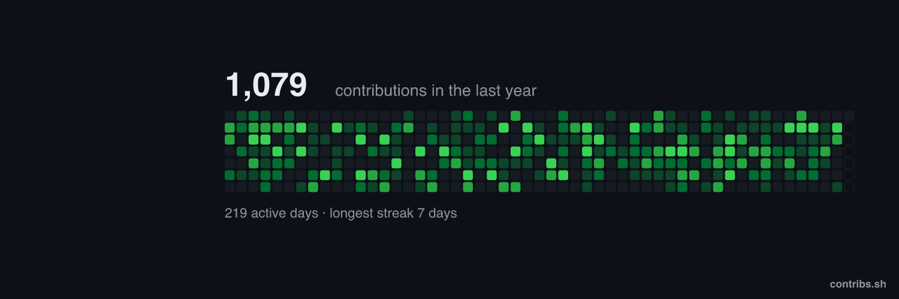
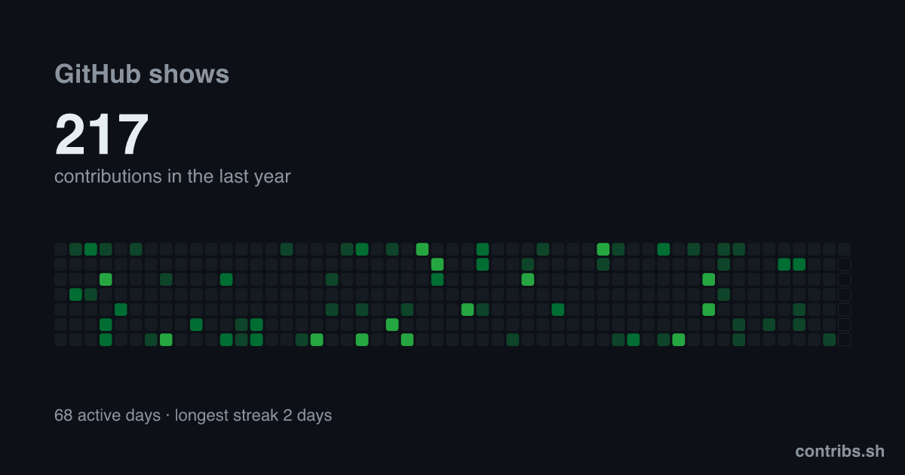
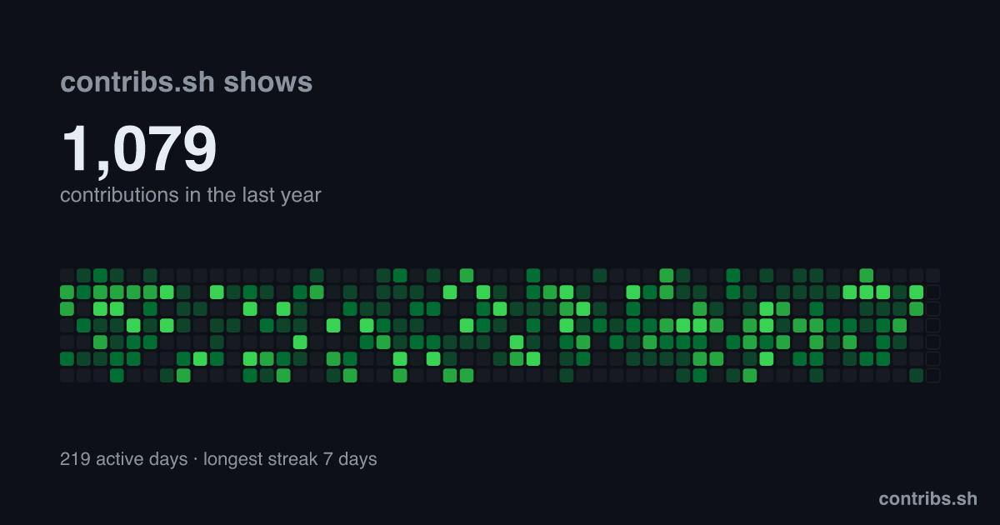
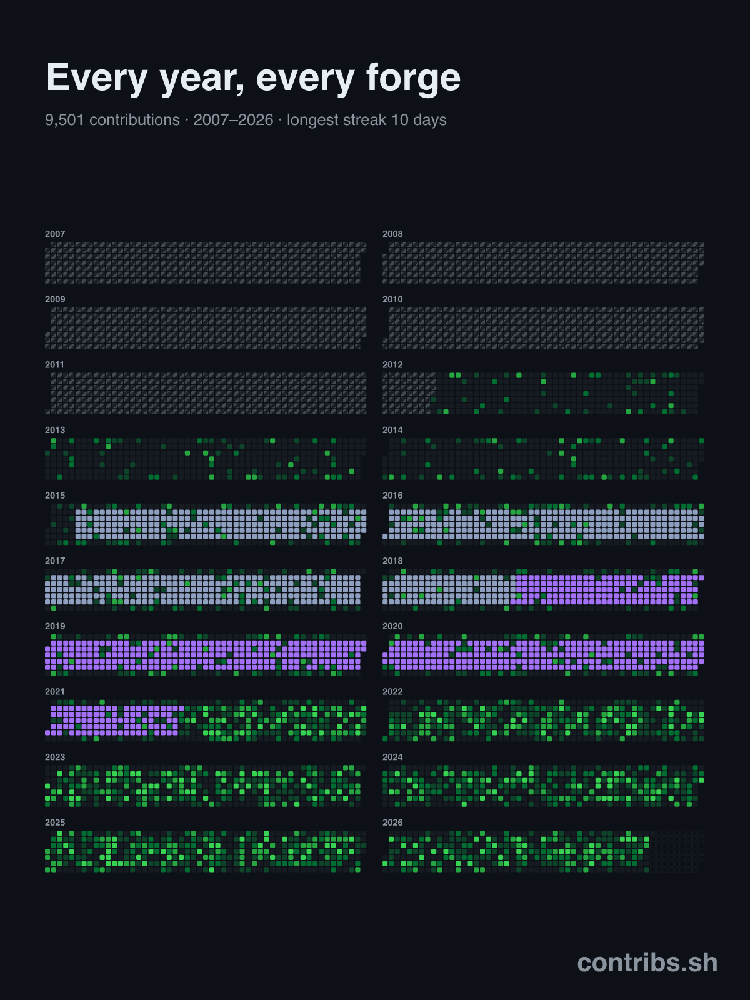

# contribs.sh

**Every contribution, every forge, one heatmap.** Your GitHub graph only shows one account on one
platform. contribs.sh merges every account you've used, counts commits from repos still on your disk,
and exports the result as a banner for X, LinkedIn and more.



```bash
npx contribs.sh init      # sources.json for your gh login
npx contribs.sh banner    # → contribs-x.png
```

| GitHub shows | contribs.sh shows |
| --- | --- |
|  |  |

Years that live on another platform can be recovered from local repos (`contribs.sh scan`) or marked
as lost history, and show up on the all-years poster:

<p align="center"></p>

<sub>Images are generated from synthetic data by `npm run demo`.</sub>

## The dashboard

A browser dashboard for your contribution history, merged across **multiple sources** —
github.com accounts, GitHub Enterprise, and Forgejo/Gitea instances (e.g. Codeberg) — rendered
with [`@json-render/react`](https://json-render.dev). It distinguishes genuine zero-activity days
from days where no source has data (lost / pre-migration history), which render as a distinct
hatched "no data" cell, and lets you annotate periods your work lived on another platform.

## Make it your own

Everything personal (which accounts to fetch, your lost/incomplete periods, tokens, generated data)
is gitignored — the repo ships `.example` templates, so a fresh clone builds with neutral defaults.
To run your own version:

```bash
git clone <your-fork-url> && cd contribs.sh
npm install

cp sources.example.json sources.json        # edit: your accounts (see "Configuring sources")
cp lost-ranges.example.json lost-ranges.json # optional: periods on other platforms / lost history

npm run fetch                                # pulls your data → public/data/contributions.json
npm run dev                                  # open the printed localhost URL
```

**Prerequisites:** Node 18+ and either the [`gh` CLI](https://cli.github.com/) authenticated with your
github.com account(s), or Personal Access Tokens for any source not in `gh` (see Tokens below).

## Configuring sources

`sources.json` (gitignored) lists the accounts to merge. Each entry:

| field      | meaning                                                                 |
| ---------- | ----------------------------------------------------------------------- |
| `id`       | unique slug (used for the per-source file name)                         |
| `label`    | display name in the UI                                                  |
| `type`     | `github` (github.com or Enterprise) or `forgejo` (Codeberg/Gitea)       |
| `host`     | `github.com`, your Enterprise host, or `codeberg.org`                   |
| `username` | the account's login                                                     |
| `tokenEnv` | name of the env var holding the token — **omit** for a github.com account managed by the `gh` CLI |
| `enabled`  | set `false` to keep an entry without fetching it                        |

**Tokens.** github.com accounts in your `gh` keyring need no token — the fetch script pulls one via
`gh auth token --user <username>`. Every other source reads its token from an env var named by
`tokenEnv`, loaded from a gitignored `.env` (see `.env.example`):

- **GitHub Enterprise** — a PAT with `repo` + `read:org` on the Enterprise host.
- **Codeberg / Forgejo** — an access token with `read:user`.
- **A second github.com account** not in `gh` — a PAT with `repo` + `read:org`.

Sources whose token can't be resolved are skipped with a warning, so the dashboard always builds
with whatever credentials are available.

## How it works

- **`src/fetch/`** — `npm run fetch` reads `sources.json`, runs one adapter per source
  (`adapters/github.ts` = GraphQL `contributionsCollection`; `adapters/forgejo.ts` = the
  `/api/v1/users/{user}/heatmap` REST endpoint), then `merge.ts` sums per-day counts and unions
  coverage windows into `public/data/contributions.json` (per-source files land in
  `public/data/sources/`).
- **`src/`** — the React app loads that JSON, exposes it via `contributionsContext`, and renders a
  layout described by `dashboard.json` against the json-render catalog/registry in `catalog.tsx`.
  Components (`YearHeatmap`, `StatsPanel`, `YearSelector`, `SourceLegend`) read the data from context.

A day is **known** when at least one source's coverage window includes it; unknown days carry count 0
and are excluded from streak/average stats so lost history never distorts the numbers.
Coverage ends no later than the UTC fetch date. The full current-year grid remains visible:
dates after today use a subdued outline and a "Future date" tooltip, contribute to no stats,
and cannot receive lost-history annotations. Elapsed dates after the last fetch are "No data"
until a refresh covers them. Future-date styling advances with the UTC date while the app is open.

## Marking history lost to a migration

Some real history (e.g. a Bitbucket → GitHub migration) no longer exists on any source. You can mark
those days so they render in a distinct **gray "lost"** style with a hover note, instead of looking
like zero-activity days. Edit the committed **`lost-ranges.json`**:

```json
{
  "enabled": true,
  "label": "Contribs lost due to Bitbucket migration",
  "ranges": [
    {
      "id": "bitbucket-era",
      "from": "2016-01-01",
      "to": "2020-12-31",
      "days": "weekdays",
      "weekdays": [1, 2, 3, 4, 5],
      "note": "Contribs lost due to Bitbucket migration",
      "enabled": true
    }
  ]
}
```

- `from` / `to` — inclusive ISO date range to mark.
- `days` — `"weekdays"` (Mon–Fri), `"all"` (include weekends), or `"selective"` (use the `weekdays`
  list; `0`=Sun … `6`=Sat).
- `note` — optional hover text for this range; falls back to the top-level `label`.
- `label` — optional short name shown in the legend; falls back to `id`.
- `color` — optional cell color for this range's lost days (any CSS color); falls back to a neutral
  gray. Use distinct colors to tell ranges apart at a glance.
- Only **0-contribution** days in the range are colored — days that already have contributions stay
  green. Each active range gets its own swatch in the legend.

**Toggle:** the legend has a **"Lost / incomplete"** checkbox that shows/hides the overlay live (your
choice is remembered in the browser). While it's on, each lost day counts as **1** toward **Total
contributions**, **Active days**, and **Avg / active day** — but **never** toward **Longest** or
**Current streak**, which always reflect real GitHub activity only. Turning it off reverts both the
heatmap and the stats to GitHub-only numbers.

**To remove a range entirely:** set its `"enabled": false` (or delete the entry), or flip the
top-level `"enabled": false`. Config changes apply on reload — no re-fetch.

`lost-ranges.example.json` ships a single **disabled** example range; copy it to `lost-ranges.json`,
set your real window(s), and `"enabled": true`. If `lost-ranges.json` is absent the app falls back to
the example, so the build never breaks.

## Display settings

`config.json` (committed — not personal) holds display preferences:

| field         | meaning                                                                      |
| ------------- | ---------------------------------------------------------------------------- |
| `title`       | Site name — shown as the page heading and the browser tab title.             |
| `recentYears` | In the "All years" view, how many recent years to show before the **"Show earlier years"** toggle (default `10`). Older years fade in when you expand them. |
| `startYear` | Earliest year to display (currently `2007`). Takes effect on the next fetch; years without source coverage show "No data" and do not change contribution totals. Earlier source history is still retained. |

The year filter at the top is a dropdown — jump straight to any year (including older, collapsed ones)
or back to the all-years overview.

The sticky legend's service buttons filter the heatmaps, tooltips, year totals, and stats.
GitHub controls fetched activity from every GitHub source plus any lost range labelled `GitHub`;
each other lost range (in `lost-ranges.json` order) gets its own button that toggles its
annotations. The gray Lost / Incomplete checkbox controls all annotations without hiding real
activity. Selections persist in the browser; No Data and Less–More are informational.

## Scripts

| script          | does                                            |
| --------------- | ----------------------------------------------- |
| `npm run fetch` | fetch + merge all sources → `public/data/`      |
| `npm run dev`   | Vite dev server                                 |
| `npm run build` | type-check (app + node) and production build    |
| `npm run preview` | preview the production build                   |
| `npm run banner -- ...` | render banner / card / Wrapped / poster images |
| `npm run cli -- ...` | the `contribs-sh` CLI (`init`, `fetch`, `banner`, `scan`) |

## Recovering history from local repos

Commits that never reached a hosted forge (an old employer's GitLab, an SVN repo you converted with
`git svn`, a Bitbucket repo you still have cloned) can be counted straight from disk:

```bash
npm run cli -- scan ~/code/old-work --email you@old-employer.example
```

`scan` lists commits per year and prints a `"type": "local"` source to paste into `sources.json`.
Commits are de-duplicated by hash across repos. Anything you also pushed to GitHub is already in your
GitHub graph, so set `from`/`to` to the period GitHub is missing. Recovered days are real data, so
they replace the hand-drawn `lost-ranges.json` annotation for that period.

## Exporting images

The dashboard has an **Export image** panel. It renders the same SVG the CLI uses and downloads it
as PNG or SVG:

| preset     | size         | layout                                         |
| ---------- | ------------ | ---------------------------------------------- |
| `x`        | 1500×500     | banner; content kept right of the profile photo |
| `linkedin` | 1584×396     | banner                                         |
| `og`       | 1200×630     | card                                           |
| `github`   | 1280×640     | card (repo social preview)                     |
| `wrapped`  | 1080×1350    | year-in-review story with stats                |
| `poster`   | 5400×7200    | every year, 18×24 in at 300 dpi                |

From the command line (renders with `resvg`, no browser):

```bash
npm run banner -- --preset x                         # contribs-x.png
npm run banner -- --preset wrapped --range 2026 --title "2026 in code"
npm run banner -- --preset poster --theme light --out poster.png
npm run banner -- --preset all --out banners/        # every preset, PNG + SVG
```

Options: `--range rolling|all|YEAR`, `--theme dark|light`, `--title`, `--scale`, `--no-stats`,
`--no-mark`, `--transparent`. Lost ranges from `lost-ranges.json` are drawn in their colors.

## CLI

Install with `npx contribs.sh <command>` (or `npm i -g contribs.sh`; the binary is `contribs.sh`, with `contribs-sh` as an alias). Inside a clone, `npm run cli --` runs the same thing:

```bash
contribs.sh init [--ci]      # sources.json for your gh login; --ci adds the Pages workflow
contribs.sh fetch            # same as npm run fetch
contribs.sh banner [...]     # see above
contribs.sh scan DIR...      # see "Recovering history from local repos"
```

## Self-hosting with GitHub Actions

`.github/workflows/contribs.yml` refreshes the data daily, builds the dashboard, renders every banner
preset, and publishes to GitHub Pages. It does nothing until configured, so forks are safe:

1. Repo → Settings → Secrets → Actions: add `CONTRIBS_SOURCES` (your `sources.json`, with a
   `tokenEnv` on every source), one secret per `tokenEnv` (e.g. `GH_MAIN_TOKEN`, a classic PAT with
   `read:user`, `repo`, `read:org`), and optionally `CONTRIBS_LOST_RANGES`.
2. Settings → Pages → Source: **GitHub Actions**.
3. Run the workflow once from the Actions tab.

Your banners are then at `https://<you>.github.io/<repo>/banners/x.png` (and `.svg`), ready to embed in
a README or site. Add extra token secrets to the `env:` block of the "Fetch, build, render banners" step.

## Deploying

The app is a static site — the only runtime input is `public/data/contributions.json`, produced by
`npm run fetch`. To publish:

```bash
npm run fetch     # refresh your data (needs gh/tokens; do this wherever you build)
npm run build     # outputs dist/
# deploy dist/ to GitHub Pages, Vercel, Netlify, Cloudflare Pages, etc.
```

Because `sources.json`, `lost-ranges.json`, and `public/data/` are gitignored, the simplest path is to
**fetch + build + deploy from your own machine**. To deploy from CI instead, provide those files to the
CI job (e.g. commit a token-free `lost-ranges.json`, recreate `sources.json` from a secret, and run
`gh auth login` / set token env vars) before `npm run fetch`. Re-run `fetch` on a schedule to keep the
graph current.
